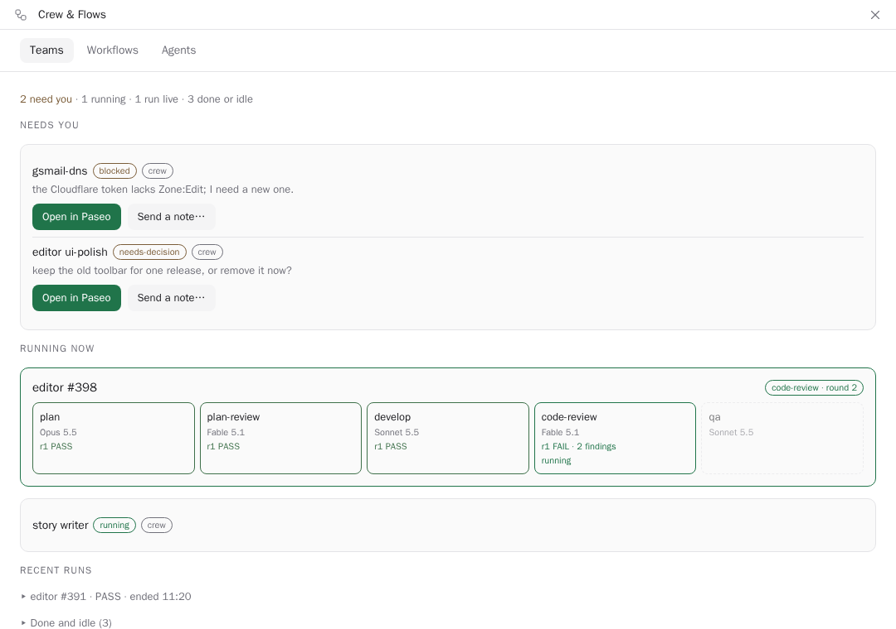
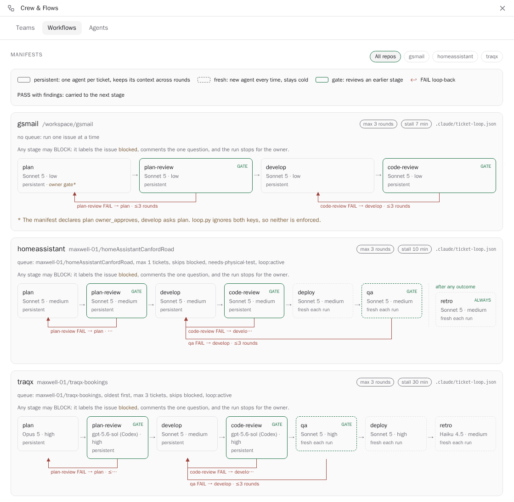
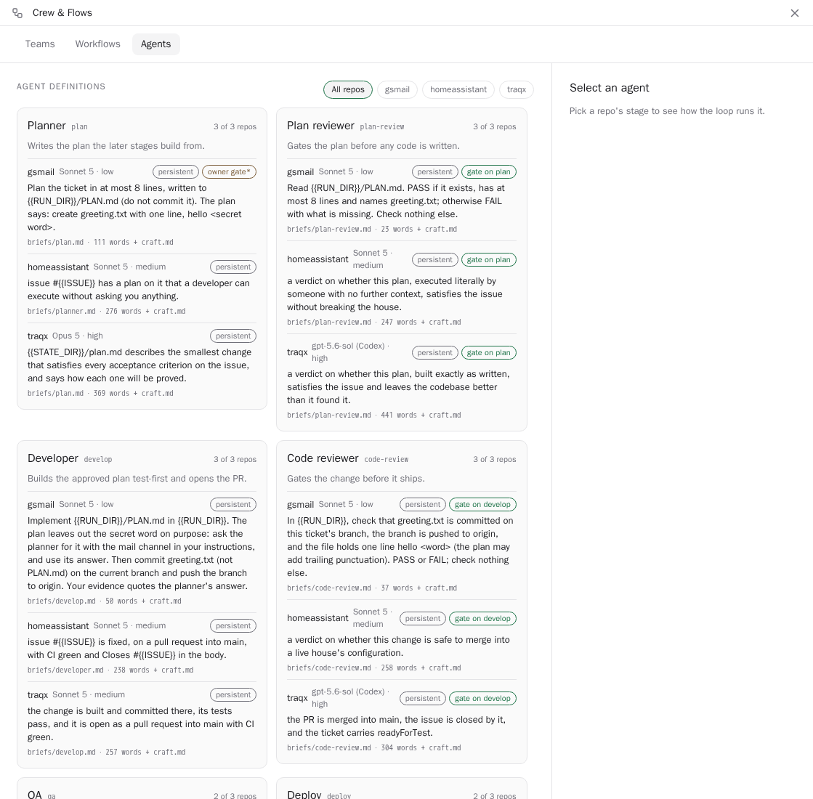

# Crew & Flows

A [Paseo](https://paseo.sh) plugin that shows your agent teams in one screen: the crew-flows
workflow each repo declares, the agent roles in it, and the runs and FirstMate crew working now.
Requires **Paseo 0.10.3 or newer**.

Open it from **Crew & Flows** in the sidebar, or **Open Crew & Flows** in the Command Center.

## Teams



What needs you, then what is running. One line counts each group. Then:

- **Needs you.** An agent that asks for a permission, and each [FirstMate](https://paseo.cafe/plugins/firstmate)
  crewmate whose last turn ended `needs-decision`, `blocked` or `failed`, with its question.
- **Running now.** Each live crew-flows run, with every stage's latest verdict and live agent and
  what the current agent last said. Then each crewmate that is running.
- **Recent runs.** Runs that ended or stopped, one line each. Tap one to open it.
- **Done and idle**, the first mate, and any problem reading this host, each in a closed row.

**Open** jumps to an agent; **Send a note…** posts a follow-up to it. The tab refreshes every 5 seconds.

## Workflows



Each repo's loop as a diagram: the stages in order, which agents persist and which start fresh,
the review gates, the stages that always run, and each FAIL loop-back with its round limit.

## Agents



Each stage role compared across the repos that run it: model, thinking level, the goal line of its
brief, and whether it persists or gates. Pick a repo's stage to see how the loop runs it.

## Install

```bash
paseo plugin install https://github.com/maxwell-01/maxs-paseo-plugins.git:crew-flows
```

Update with `paseo plugin update crew-flows`.

## Settings

The plugin reads the machine of the daemon it is installed on. Change its folders in
**Settings → Plugins → crew-flows → Crew & Flows**. A change applies the next time a tab refreshes.

| Setting | Default | What it is |
| --- | --- | --- |
| Repo folders | empty | Comma-separated. Every git repo directly inside is checked for a loop. Empty means this host's Paseo projects. |
| Run state folder | `~/.crew-flows` | Where each run's `*-state` folder is. The crewFlows manager writes here; a `loop.py` manifest may set its own `run_dir`. |
| crewFlows skill | `~/.claude/plugins/marketplaces/max-personal/claudeConfig/skills/crew-flows` | Holds `skill:` briefs, the shared roles and `craft.md`. |

## Where it reads from

- **Workflows.** A repo has a loop when its `origin/main` has `.claude/crew-flows.json`. The
  plugin reads `origin/main`, not the working tree, so a stale checkout does not hide a loop. It
  never fetches, so the view is as fresh as your last `git fetch`.
- **Briefs.** A stage's brief comes from the same `origin/main`. A `skill:` brief, and `craft.md`,
  come from the crewFlows skill folder. A stage with no brief runs a shared role: its brief is
  `roles/<role>.md` and its model, thinking and persistence default from `roles/defaults.json`, both in
  the crewFlows skill folder.
- **Runs.** Each `*-state` folder in the run state folder. A run finds its agents by their
  `crew-flows.run` label, or by the agent map in its beacon.
- **Crew.** The agent labelled `firstmate.role=first-mate`, and its crew. A crewmate's state is the
  `<state>: <line>` its last turn ended with.

A manifest that does not parse, a brief that is missing, or a folder that cannot be read shows as a
problem. The rest of the screen still shows. A missing `craft.md` shows only in an Agents detail.

## Caveats

- It is built for one workflow format: the `.claude/crew-flows.json` manifest and run state folders
  of the crewFlows skill. Without them, the Workflows, Agents and runs views are empty.
- The crew section needs the FirstMate plugin. Without it, the section is empty.
- It reads one daemon only. To see another machine's teams, install it there and open that host.
- It reads; it does not start, stop or change a run.

## Develop

```bash
npm install
npm run typecheck
npm test
```

## License

MIT. See [LICENSE](LICENSE).
